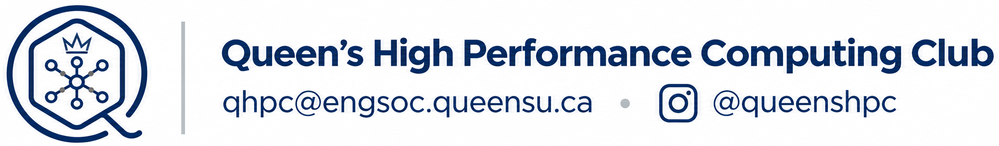

# Queen’s High-Performance Computing Club

Queen’s High-Performance Computing Club (QHPC) is Queen’s first student supercomputing club. We give students hands-on experience with high-performance computing and the tools used in modern research and industry.

High-performance computing brings powerful systems together to solve problems that are too large, slow, or complex for a typical computer - from scientific simulations and weather forecasting to AI and machine learning.

This year marks QHPC’s second year since EngSoc ratification. We’re expanding our technical programming, developing new project and research opportunities, and exploring participation in external HPC competitions, conferences, and training programs.

## What we explore

Through workshops, collaborative projects, and research members build practical skills in:

- Linux, cluster computing, and large-scale computing systems.
- Parallel programming, GPUs, and performance optimization.
- Scientific computing, simulation, and AI/ML.

## Our GitHub Organization

Explore the resources behind our workshops, hands-on activities, and student project ideas.

| Explore | What you’ll find |
| --- | --- |
| [Meetings and activities](https://github.com/Queen-s-High-Performance-Computing/qhpc-meetings) | Short guides, sample code, and practical tasks to work through during meetings or at your own pace. |
| [Projects and research](https://github.com/Queen-s-High-Performance-Computing/qhpc-research) | Research proposals and supporting material for exploring new project ideas. |

## Get involved

Students from every faculty and experience level are welcome. No previous coding or HPC experience is required - just curiosity and a willingness to learn.

- **Start learning:** Explore our [meeting guides and activities](https://github.com/Queen-s-High-Performance-Computing/qhpc-meetings).
- **Connect with QHPC:** Find our [socials and resources on Linktree](https://linktr.ee/queenshpcclub).
- **Contact us:** [qhpc@engsoc.queensu.ca](mailto:qhpc@engsoc.queensu.ca).

